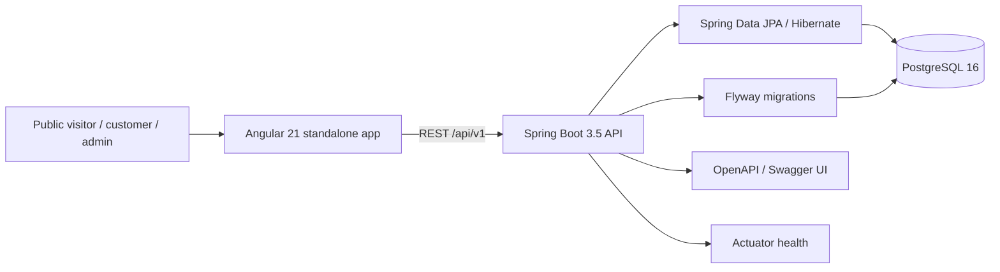

# Architecture — 9-Eleven Automotive Hub

## Phase 1 architecture

## Backend conventions

- Package by business capability. A feature can contain controller, service, repository, entity, DTO and mapper layers as it is implemented.
- Controllers are HTTP adapters. Validation and business rules belong in services; persistence entities must not be returned directly from endpoints.
- UUID primary keys, UTC timestamps, audit metadata, optimistic locking via `@Version`, and soft-delete timestamps are used where applicable.
- PostgreSQL schema changes are managed only through Flyway. Hibernate uses `ddl-auto=validate`, including in the production profile.
- Errors use Spring `ProblemDetail` (RFC 7807-compatible), with a `fieldErrors` extension for bean validation failures.
- A correlation ID is returned as `X-Correlation-Id` and included in the logging pattern.

## Frontend conventions

- Angular standalone components and lazy-loaded feature routes.
- `core/` is reserved for API/auth infrastructure; `shared/` is reserved for reusable UI components; `features/` separates public, customer and admin capabilities.
- Tailwind CSS uses the workshop palette: yellow `#FFD400`, charcoal `#151719`, and neutral grey/white.
- Admin and customer routes are non-authenticated placeholders in Phase 1; authorization guards arrive in Phase 2.

## Security boundary

This phase is a foundation, not a production-ready authenticated application. The status API and static site are public. There are no real customer records, tokens, passwords, upload routes or operational actions yet. Never expose the local Compose credentials publicly. Authentication, ownership enforcement, secure cookies, rate limits, file validation, audit event population and production secrets are addressed in later phases.
