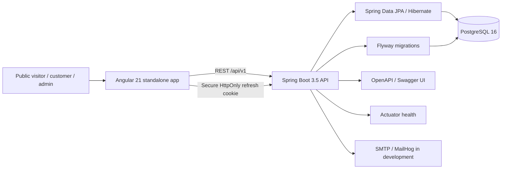

# Architecture — 9-Eleven Automotive Hub

## Phase 1 and Phase 2 architecture

The Phase 1 foundation provides the schema, public shell, status API, error contract, and operational wiring. Phase 2 adds stateless Spring Security resource-server authentication, JWT access tokens, refresh rotation, email verification and reset, customer profile access, and role-guarded Angular shells. The domain workflows and other portal features remain in their assigned phases.

## Backend conventions

- Package by business capability. A feature can contain controller, service, repository, entity, DTO and mapper layers as it is implemented.
- Controllers are HTTP adapters. Validation and business rules belong in services; persistence entities must not be returned directly from endpoints.
- UUID primary keys, UTC timestamps, audit metadata, optimistic locking via `@Version`, and soft-delete timestamps are used where applicable.
- PostgreSQL schema changes are managed only through Flyway. Hibernate uses `ddl-auto=validate`, including in the production profile.
- Errors use Spring `ProblemDetail` (RFC 7807-compatible), with a `fieldErrors` extension for bean validation failures.
- A correlation ID is returned as `X-Correlation-Id` and included in the logging pattern.
- Authentication uses Spring Security 6 with stateless bearer JWTs. Roles are `ADMIN` and `CUSTOMER`; `/api/v1/admin/**` and `/api/v1/me/**` are separately restricted.
- Passwords are BCrypt hashes. Access JWTs live for 15 minutes. Opaque refresh tokens live for 30 days, are stored as SHA-256 hashes, rotated on use, and grouped into a revocable family.
- Login locks after five failed attempts for 15 minutes. A Bucket4j in-memory limit applies to auth routes. The Compose web proxy has a fixed trusted network address; Nginx overwrites incoming `X-Forwarded-For`, and the API only uses that header when the socket peer matches the configured trusted proxy address.
- Email verification links expire after 24 hours; password reset links expire after 30 minutes. Tokens are random, single-use, and stored hashed.
- The first admin is seeded only when `ADMIN_EMAIL` and `ADMIN_INITIAL_PASSWORD` are both configured. Its first login requires password change.
- Auth events for successful/failed login and password reset are written to `audit_log`.

## Frontend conventions

- Angular standalone components and lazy-loaded feature routes.
- `core/` is reserved for API/auth infrastructure; `shared/` is reserved for reusable UI components; `features/` separates public, customer and admin capabilities.
- Tailwind CSS uses the workshop palette: yellow `#FFD400`, charcoal `#151719`, and neutral grey/white.
- `/admin` and `/portal` use role-guarded Phase 2 shells; their business screens are not implemented yet.
- The access token is held in memory. The HTTP interceptor sends it as a bearer token, attempts one refresh after a 401, then retries the failed request once. The refresh cookie is never exposed to JavaScript.
- Angular development proxies `/api` to the local backend. Compose serves web and API through same-origin Nginx routing.

## Security boundary

Authentication is now implemented, but the product is not yet a production-ready workshop system. Catalog, job ownership workflows, operational screens, media, billing, and notifications remain unimplemented. Refresh cookies use `Secure`, `HttpOnly`, `SameSite=Strict`, and the `/api/v1/auth` path. CORS allows only the configured `FRONTEND_ORIGIN`. Change all local secrets and credentials and use managed secret storage before public deployment. The current Bucket4j limiter is process-local; horizontally scaled deployments need a shared bucket store and trusted-proxy/IP handling.
