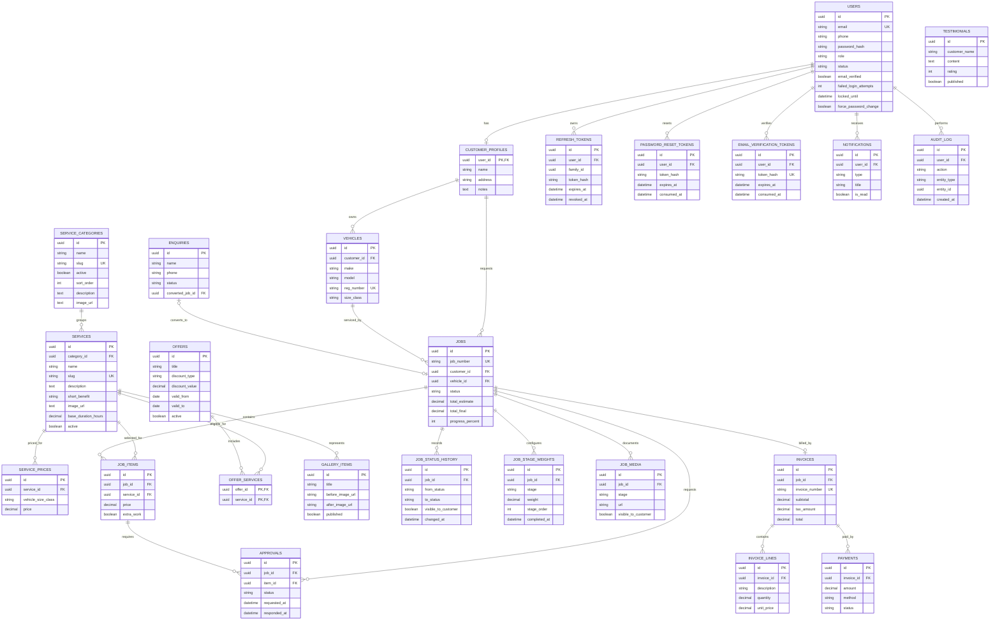

# Target ER diagram

The schema is introduced in the Phase 1 Flyway migration so later phases can implement domain workflows against stable table names. The job state machine, progress weighting rules and all business CRUD behaviors are implemented in their assigned phases.

## Required indexes included

- `jobs(customer_id, status)` — partial index for non-deleted jobs.
- `vehicles(reg_number)` plus a case-insensitive unique index for active registration numbers.
- `job_status_history(job_id, changed_at DESC)`.
- `job_stage_weights(job_id, stage_order)` for ordered, per-job progress weights; progress is derived from completed stages.
- `job_number_seq` provides a sequential counter for human-friendly job numbers.
- Refresh tokens are indexed by user/expiry and family; each bearer token is stored as a SHA-256 hash, with rotation/revocation state and replacement linkage.
- Password reset and email verification token hashes are unique and indexed by user/expiry.
- Supporting indexes cover job queues, service catalog lookups, customer notifications, enquiry triage, invoice lines and audit history.

## Phase 3 catalog schema

Flyway V3 adds unique slugs, `sort_order`, and category/service image and service short-benefit fields. It seeds eight active service categories and 24 services. No service price rows are seeded; prices are entered by an administrator for each vehicle size class. Flyway V4 constrains `service_prices.vehicle_size_class` and nullable `vehicles.size_class` to SMALL, MEDIUM, LARGE, or SUV only when the existing data in that column satisfies the constraint. The backend uses the `VehicleSizeClass` enum for service-price input validation.
